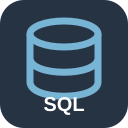

# Olá, eu sou o Felipe Silva!

### Engenheiro de Software | Dev Full Stack & AI Engineer

## Sobre mim

Sou formado em **Engenharia de Software pela PUC-Campinas** e tenho experiência profissional no desenvolvimento e na manutenção de aplicações web corporativas. Atuo em diferentes etapas do desenvolvimento de software, do frontend e backend à integração de APIs, bancos de dados e testes automatizados.

Trabalhei com **C#/.NET, React, Next.js e Oracle** em soluções empresariais e, em projetos próprios, exploro tecnologias como **Node.js, TypeScript, NestJS e PostgreSQL**. Tenho especial interesse em **arquitetura de software, desenvolvimento backend e integração de inteligência artificial** para automatizar processos e resolver problemas reais.

## Tecnologias e ferramentas

### Linguagens

  
  
  
  
  
  

### Frontend e mobile

  
  
  
  

### Backend

  
  
  

### Bancos de dados e ORMs

  
  
  
  

### Cloud, DevOps e testes

  
  
  
  
  
  

### Desenvolvimento com IA

## Experiência profissional

### Desenvolvedor Full Stack — Becomex Lab

*Estagiário de Desenvolvimento de Software → Desenvolvedor Júnior*

- Desenvolvimento e manutenção de aplicações web corporativas com **C#/.NET, React, Next.js e Oracle**.
- Implementação de funcionalidades, integrações entre sistemas, operações em banco de dados e testes automatizados.
- Participação no desenvolvimento de uma **solução com IA** que reduziu em aproximadamente **70%** o tempo de anexação de documentos em um produto utilizado por mais de **100 empresas**.

`C#/.NET` · `React` · `Next.js` · `Oracle` · `Azure`

## Projetos em destaque

<table>
  <tr>
    <td width="50%" valign="top">
      <h3>Fast Market</h3>
      
Plataforma web e mobile para comparação de preços de supermercados, gestão de listas de compras, despensa digital, pedidos e controle de estoque para estabelecimentos.

      
<code>React</code> <code>React Native</code> <code>NestJS</code> <code>PostgreSQL</code> <code>Stripe</code>

      
<strong>Projeto acadêmico · Repositório privado</strong>

    </td>
    <td width="50%" valign="top">
      <h3>AI Workout Assistant</h3>
      
Bot do Telegram para registro de treinos, acompanhamento de cargas e repetições e análise de desempenho e evolução com modelos de linguagem. &nbsp;

      
<code>Node.js</code> <code>TypeScript</code> <code>Prisma</code> <code>PostgreSQL</code> <code>IA</code>

      
<a href="https://github.com/FeMafissioni/gym-ai-assistant"><strong>Ver repositório</strong></a>

    </td>
  </tr>
</table>

## Formação e cursos

**🎓 Bacharelado em Engenharia de Software**  
Pontifícia Universidade Católica de Campinas (PUC-Campinas) · **Concluído em 2025**

**📜 Cursos concluídos — Udemy**

- **Azure Pipelines - CI/CD, Docker e Kubernetes no Azure DevOps**
- **Docker para Desenvolvedores (com Docker Swarm e Kubernetes)**
- **Formação Microsoft Power BI Professional**

## Atualmente estudando

- **🧠 Engenharia de IA:** RAG, MCP, aplicações com modelos de linguagem e fluxos de desenvolvimento assistidos por IA.
- **🧩 Arquitetura de Software:** design de sistemas, padrões de projeto, sistemas distribuídos e escalabilidade.
- **☁️ Cloud e DevOps:** Docker, Kubernetes, infraestrutura em nuvem e pipelines de CI/CD.

## Atividade no GitHub

## Além do código

Fora do trabalho, gosto de experimentar novas tecnologias e desenvolver projetos paralelos que transformam ideias em soluções práticas. Também tive a oportunidade de morar, estudar e trabalhar na **Irlanda**, experiência que fortaleceu minha comunicação em inglês e ampliou minha perspectiva internacional.

## Contato

Estou aberto a conexões, trocas de conhecimento e conversas sobre oportunidades em engenharia de software e desenvolvimento com IA.

